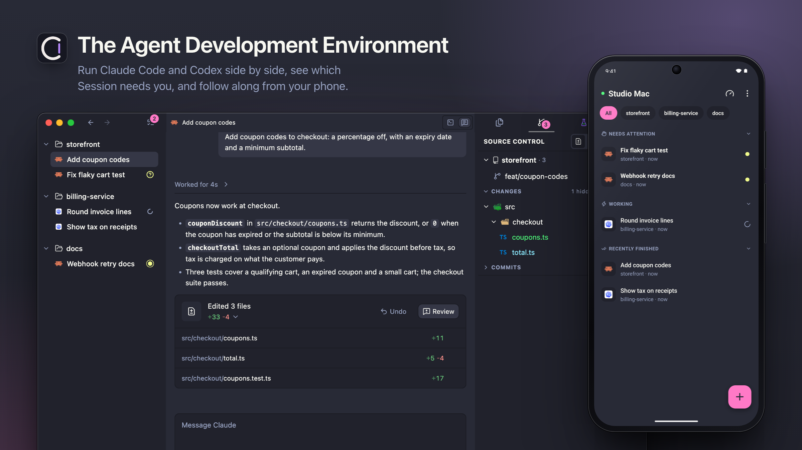

# Caxri

[English](README.md) | 简体中文



Caxri 是一款 Agent 开发环境（Agent Development Environment，ADE）：在一个桌面应用里，用你已在使用的编码 Agent（Claude
Code、Codex 和 Grok Build）构建软件。你可以同时运行很多 Agent，一眼看出哪个在等你，审阅它改了什么，日常重度使用 Agent
带来的各种琐事则交给 Caxri 处理。Agent 变化很快，所以 Caxri 频繁发布，随之调整。

**支持：** Claude Code、Codex 和 Grok Build。Caxri 运行你自己安装的 Agent CLI，沿用它们已有的登录状态；它不捆绑任何 Agent
或订阅，也不需要注册 Caxri 账号。每支持一个 Agent 都意味着持续的维护成本，所以 Caxri 先覆盖日常在用的这几个，其他 Agent
按需求加入；想用的 Agent 请[提交 Issue](https://github.com/tjx666/caxri/issues/new/choose)。界面提供英文和简体中文。

**Caxri 目前是预览版。** 它发布频繁，尚无兼容性承诺，因此某次更新可能需要重置本地数据，即
`~/Library/Application Support/Caxri` 中的配置档（见[卸载与重置](#卸载与重置)）。你的项目文件夹从不在重置范围内。源码公开和已发布的版本都不改变这一点；维护者会明确宣布任何兼容性承诺。

## 亮点

- **所有 Agent，同一套用法。** Claude Code、Codex 和 Grok Build 共用同样的会话、对话界面、通知和用量统计，换 Agent
  不用重新学一个工具。
- **对话与终端，同时在手。** 一个会话里可以同时打开多个 Agent 对话和终端。每个 Agent 既能以易读的对话（Chat）打开，也能以它真正的终端界面打开，两者随时切换，对话不丢失。
- **为重度 Agent 用户而做。** 整天跑 Agent 的琐事由 Caxri 自动处理：在提示缓存过期前压缩空闲对话，用量限额重置后自动恢复
  Agent，挂起闲置的后台 Agent，并实时显示 Agent 的输出速度（tok/s）。用量就在状态栏：悬停查看套餐限额，点击打开按 Agent 展示 token 和成本的用量页。
- **谁在等你，一目了然。** 每个会话都会报告等待中、已完成或失败。活动视图跨所有项目列出等你处理的会话，桌面通知会提醒你，配对的手机上也能看到同一份列表。
- **需要时才有 worktree。** 直接在项目里开始对话，不必先指定 worktree。worktree 归在所属项目下面；Agent
  在对话中途创建或进入某个 worktree 时，会话的文件、编辑器和 Git 视图会自动切过去。
- **把工作交给另一个 Agent。** 在新会话里输入 `@`，就能把之前的某段对话交给新的 Agent；或者运行 `/new-session`，让当前 Agent
  写好交接说明并开一个新会话。套餐用完时，Caxri 也会提议换另一个 Agent 继续。
- **审阅与交付，不离开应用。** 在 diff 上写评论并一键发给 Agent。状态面板展示会话的拉取请求、检查状态和关联 issue；在 Caxri
  里合并后，Agent 会收到合并通知。提交由 Agent 完成，合并由你决定。

### 还有这些

- **移动端。** 通过局域网、Tailscale 或你自己部署的 Relay 在手机上查看会话、回复 Agent，全程端到端加密。
- **远程机器。** 通过 SSH 打开 Linux 或另一台 Mac 上的项目，Agent、终端和 Git 都在那台机器上运行，体验和本地一致。Caxri
  Server 也可以脱离桌面端独立运行。
- **归档。** 做完的会话可以归档，让侧边栏保持清爽，随时能恢复；拉取请求合并后，会话也可以自动归档。
- **飞行模式。** 断网前一键干净地停下所有 Agent，回来后再挑选要恢复的会话。
- **`caxri` 命令行。** Agent 可以用它创建会话、把工作委派给其他 Agent 并汇报结果。
- **关联工作项。** 拉取请求、Linear issue 和 LobeHub 验收报告显示在产生它们的会话旁边。
- **主题。** 跟随 macOS 外观的浅色和深色主题，也可以导入自定义主题。
- **轻量编辑器。** 用于检查 Agent 工作的文件树、搜索和编辑器，不会变成 IDE。

## Caxri 与其他工具的区别

- **直接在终端里运行 Claude Code 或 Codex。** Caxri 运行的是同样的 CLI，使用它们自己的登录状态，Agent
  本身没有任何变化。它补上的是外围的一切：持久的会话、易读的对话、跨多个 Agent 的关注提醒、用量自动化和审阅工具。
- **Conductor、Superset、Orca 等并行 Agent 工作台。** 它们同样借助 Git worktree 并行运行多个 Agent，并提供 diff
  审阅。Caxri 的侧重点是：Claude Code、Codex 和 Grok Build 之间统一的工作流；对话和终端都是一等模式；围绕套餐限额和提示缓存的自动化；以及只显示仍需要你处理的内容。它也不会要求你在开始对话前先选好 worktree。
- **Cursor 等 AI IDE。** Caxri 不是 IDE，不会取代你的编辑器。它完全从头开发，不是 VS Code 的分支，但编辑器、状态栏和命令面板会让
  VS Code 用户很快上手。编辑器和源代码管理视图保持轻量，用于查看 Agent 做了什么。
- **运行按钮和任务启动器。** Caxri 不提供提交、推送、构建或运行脚本的按钮。把这些固定流程写成 skill，交给 Agent 执行即可。Caxri
  唯一保留的按钮是合并拉取请求，因为这个决定应该由你来做。

初次使用？阅读[入门指南](docs/getting-started.md)，五分钟了解基本模型。

## 系统要求

- 运行 macOS 13（Ventura）或更高版本的 Apple 芯片 Mac。
- 至少安装并登录一个受支持的 Agent CLI（Claude Code、Codex 或 Grok Build）。请先确认它能在终端中正常使用。Shell 会话不需要 Agent CLI。

发布版本目前仅支持 Apple 芯片；Intel Mac 可以从源码构建 Caxri（见
[CONTRIBUTING.md](CONTRIBUTING.md)）。其他桌面平台暂未支持。远程 SSH 主机可以是 Linux 或 macOS。

## 安装

在终端中运行：

```bash
curl -fsSL https://raw.githubusercontent.com/tjx666/caxri/main/install.sh | bash
```

它只依赖 macOS 自带的工具：下载最新版本，与发布的 SHA-256 不一致时拒绝安装；新副本就位后才替换
`/Applications/Caxri.app`（安装失败会保留旧版本）；只清除 Caxri 自身的下载隔离属性。再次运行即可更新，
你的项目、会话和设置不会被改动。

或者把下面这段话粘贴给你的编码 Agent（Claude Code、Codex、Grok Build 或类似工具）：

```text
Install Caxri for me by following https://raw.githubusercontent.com/tjx666/caxri/main/docs/install.md
```

Agent 会检查你的 Mac，用同一个脚本安装 Caxri，并提供可选设置：`caxri` 命令，以及语言、默认 Agent、字号等初始设置。若要手动安装，请按同一页面操作：
[docs/install.md](docs/install.md)。

**Caxri 目前尚未经过 Apple 公证。** 如果 macOS 提示 Apple 无法验证 Caxri，打开**系统设置 → 隐私与安全性**点击**仍要打开**，或者运行一次下面的命令，然后重新打开：

```bash
xattr -dr com.apple.quarantine /Applications/Caxri.app
```

如果你是手动下载的磁盘映像，请先用对应的 `.sha256` 文件校验它。
[故障排查](docs/troubleshooting.md#macos-says-caxri-is-damaged-or-blocks-it)还说明了被 macOS 报告为"已损坏"的旧版本如何处理。

### 在 Android 上安装

Android 手机可以从同一个 [Release](https://github.com/tjx666/caxri/releases/latest) 安装配对的移动端：下载
`Caxri-Mobile-<version>-android-arm64.apk`，打开它，并在提示时允许浏览器或文件管理器安装应用。每个 APK 都附带
`.sha256` 校验文件；请使用与桌面端相同的版本。见[移动端安装与更新](docs/mobile/update.md#install-from-github-releases)。

## 第一个会话

把一个本地文件夹添加为项目，在其下创建会话。在会话里点击 **+** 启动默认 Agent，或者把鼠标悬停在 **+** 上，选择其他 Agent、对话或终端模式，或者普通终端。Agent
默认以对话打开；你可以随时把 Agent 切换到它的终端。

Agent 默认拥有完全访问权限：它们无需询问即可编辑文件和运行命令。可以在**设置 → Agent**中修改。如有提示，请在 macOS
系统设置中允许辅助程序发送通知。

## 更新

Caxri 在启动时以及之后每隔几小时检查 GitHub 上的新版本。你也可以随时选择 **Caxri → 检查更新…**。新版本会在后台下载；准备就绪后，选择**重启以更新**，或者直接退出
Caxri，下次启动即为新版本。如果 Caxri 无法替换自身（例如它是从磁盘映像中运行的），对话框会说明如何手动安装已下载的磁盘映像。更新不会删除你的配置档或项目文件夹。见[桌面端更新](docs/desktop-updates.md)。面向贡献者的发布选项见
[RELEASING.md](RELEASING.md)。

## 面向应用用户的命令行

打开命令面板并运行**在 PATH 中安装 'caxri' 命令**，然后在新的终端中执行：

```bash
caxri --help
```

完整手册见 [docs/cli.md](docs/cli.md)。

## Caxri 会在你的 Mac 上改动什么

- **Agent hook 条目（默认关闭）。** 除非你开启生命周期 hook，否则 Caxri 不会改动你的 Agent 配置。对话从不需要它们。在终端中运行的
  Agent 用它们报告何时开始、等待或结束，使会话状态、未读标记和通知保持准确；Grok Build 必须开启它们才能在终端中运行。缺少 hook 的终端
  Agent 会提示你开启。开启后，Caxri 只会在 `~/.claude/settings.json`、`~/.codex/hooks.json` 或
  `~/.grok/hooks/caxri.json` 中添加带有自身标记的条目。在 Caxri 之外，这些条目会立即退出，并且只接收生命周期阶段，从不接收提示词或回复内容。可以在**设置
  → Agent**中按 Agent 关闭，这会移除 Caxri 的条目；你自己的 hook 保持不变。
- **用于 Claude 窗口的后台任务（Claude Pro）。** **保持 5 小时窗口滚动**（设置 → Agent → Claude）对 Claude Pro
  账户默认开启，对 Max 默认关闭。开启后，Caxri 会在 `~/Library/LaunchAgents` 下注册一个按用户运行的 launchd 任务（名称以
  `com.caxri.app.claude-windows` 开头；macOS 会把它列在登录项中），在窗口重置时向 Claude 发送一个最小请求。关闭该设置即可移除它。见
  [docs/claude-windows.md](docs/claude-windows.md)。
- **`caxri` 命令链接（仅在你安装后存在）。** 命令面板中的**在 PATH 中安装 'caxri' 命令**会创建符号链接
  `/usr/local/bin/caxri`。删除应用前请运行**从 PATH 中卸载 'caxri' 命令**，或之后用 `sudo rm /usr/local/bin/caxri`
  移除。
- **通知辅助程序。** Caxri 在应用内附带 [`alerter`](https://github.com/vjeantet/alerter)（`Contents/Resources/bin/alerter`），只用它显示通知横幅。
- **你的数据。** 配置档（数据库、设置）位于 `~/Library/Application Support/Caxri`，日志在其中的 `logs`
  文件夹。使用**帮助 → 在访达中显示日志**打开它们。
- **两类网络请求。** Caxri 会向 GitHub 的公开发布 API 查询新版本；在 Claude 窗口设置开启期间，还会向 Claude
  发送上文所述的那个最小请求。它没有遥测，诊断信息中也从不包含源代码内容、终端输出或 Agent 对话记录。你的 Agent CLI
  按各自的条款与各自的厂商通信。

## 卸载与重置

退出 Caxri，删除 `/Applications/Caxri.app`，再删除 `~/Library/Application Support/Caxri`
以清除其数据。在 Caxri 中删除项目或会话从不触碰你的文件夹或文件。删除之前，请在设置中关闭 Agent hook 和**保持 5 小时窗口滚动**（对
Claude Pro 默认开启），以便 Caxri 移除它的配置条目和后台任务。如果你安装了 `caxri` 命令，也请在命令面板中运行**从 PATH 中卸载
'caxri' 命令**（或之后执行 `sudo rm /usr/local/bin/caxri`）。在源码检出中，`bun run uninstall:caxri`
会预览一次完整的本地清理（hook 条目、后台任务、应用和配置档），并以归档代替删除；添加 `-- --yes` 即可执行。

## 支持与社区

- 遇到 bug、功能需求或疑问，请[提交 Issue](https://github.com/tjx666/caxri/issues/new/choose)。没有响应或解决时限（SLA）。也可以在应用中使用**帮助
  → 反馈问题**。
- 欢迎来自人和编码 Agent 的拉取请求；由维护者决定合并哪些。见 [CONTRIBUTING.md](CONTRIBUTING.md)。
- 请私下报告安全漏洞；见 [SECURITY.md](SECURITY.md)。
- 请求分流见 [SUPPORT.md](SUPPORT.md)，常见问题见 [docs/troubleshooting.md](docs/troubleshooting.md)。

## 许可证

Caxri 以 [Caxri Source-Available License 1.0](LICENSE) 源码可得（source-available）方式提供。它并非采用 OSI
批准的开源许可证。

将 Caxri 用于个人或公司工作、用它创作的产出（Outputs）赚钱、以及将私有的修改（Modifications）保持闭源，都是免费的。在遵守许可证的声明和源码可得条件下，允许免费再分发。销售、商业分发
Caxri 或其修改版，或对其访问收费，需要另行取得书面商业许可。商业条款请联系
[ytj2713151713@gmail.com](mailto:ytj2713151713@gmail.com)。

外部贡献在合并前需要接受 [Caxri 个人贡献者许可协议](CLA.md)。贡献流程见 [CONTRIBUTING.md](CONTRIBUTING.md)。本译文仅供参考，许可证与贡献者许可协议以英文原文为准。

## 开发用量

维护者个人开发 Caxri 的 token 用量与等价 API 成本快照由脚本自动更新，只维护在英文 README 中，见
[Development usage](README.md#development-usage)。

## 文档

### 使用 Caxri

| 文档                                | 内容                           |
| ----------------------------------- | ------------------------------ |
| [入门指南](docs/getting-started.md) | 五分钟了解基本模型             |
| [故障排查](docs/troubleshooting.md) | 应用被拦截、通知、找不到 Agent |
| [docs/cli.md](docs/cli.md)          | `caxri` CLI 手册               |
| [GLOSSARY.md](GLOSSARY.md)          | 产品术语：项目、会话、关注提醒 |
| [SUPPORT.md](SUPPORT.md)            | 社区支持范围与请求分流         |
| [SECURITY.md](SECURITY.md)          | 私下报告漏洞的政策             |
| [LICENSE](LICENSE)                  | 源码可得的使用条款与商业许可   |

### 参与贡献

| 文档                                                                       | 内容                                   |
| -------------------------------------------------------------------------- | -------------------------------------- |
| [CONTRIBUTING.md](CONTRIBUTING.md)                                         | Issue 与拉取请求的贡献流程             |
| [CLA.md](CLA.md)                                                           | 贡献者许可协议                         |
| [AGENTS.md](AGENTS.md)                                                     | 面向编码 Agent 的贡献者常规要求        |
| [DESIGN.md](DESIGN.md)                                                     | 权威的 UI 与交互规范                   |
| [docs/README.md](docs/README.md)                                           | 所有在用文档、ADR 与历史记录的完整索引 |
| [RELEASING.md](RELEASING.md)                                               | 未签名 DMG 的发布流程                  |
| [项目架构](.agents/skills/project-architecture/references/architecture.md) | 进程模型、恢复约定、依赖基线           |
